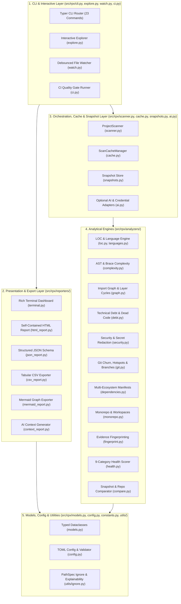

# RPX Architecture Guide

**RPX (Repository Project Explorer)** is a modular, local-first repository intelligence CLI written in Python 3.11+. Its architecture prioritizes deterministic accuracy, zero mandatory network dependencies, fast incremental scanning, and clean separation between filesystem analysis, data modeling, and presentation/export layers.

---

## 1. Layered System Architecture

RPX enforces a strict top-down dependency hierarchy across five internal layers:

---

## 2. Incremental Scan Cache Protocol (`src/rpx/cache.py`)

To make repeated scans over large repositories fast without risking stale results:

1. **Cache Location**: Stored per project under `~/.cache/rpx/scan_cache/<project_name>_<path_hash>.json` (configurable via `RPX_DATA_DIR` or `.rpx.toml`).
2. **Automatic Cache Invalidation**: Every cache payload stores:
   - `schema_version` (`1.0.0`)
   - `config_signature`: SHA-256 digest of analysis-affecting `RPXConfig` settings (exclusions, complexity thresholds, health weights).
   - `ignore_signature`: SHA-256 digest of all active ignore rules (`DEFAULT_EXCLUSIONS`, `.gitignore`, `.dockerignore`, `.rpxignore`, CLI `--exclude`).
   If any signature changes—or if `--full` is passed—`ScanCacheManager` automatically invalidates the cache and falls back to a full scan.
3. **File-Level Reuse & Diff Detection**:
   - Unchanged files (`st_mtime_ns` and `st_size` match cached metadata) reuse their cached LOC counts, SHA-256 digest, comment indicators, and `FileComplexity` AST metrics without re-reading disk contents.
   - Renamed files are detected by matching the SHA-256 digest of removed paths against newly discovered paths.

---

## 3. Code Intelligence Pipeline (`src/rpx/analyzers/`)

### 3.1 Code Complexity (`complexity.py`)
- **Python**: Uses Python's standard library `ast` module to compute exact cyclomatic complexity (decision points across `If`, `For`, `AsyncFor`, `While`, `ExceptHandler`, `With`, `Assert`, `IfExp`, `BoolOp`, `Match`, and comprehensions), function/class line spans, parameter counts (excluding `self`/`cls` on methods), and maximum control-flow nesting depth.
- **Brace-Delimited Languages** (`JavaScript`, `TypeScript`, `JSX`, `TSX`, `Go`, `Rust`, `Java`, `Kotlin`, `C`, `C++`, `C#`, `Swift`, `Dart`, `PHP`, `Scala`): Uses language-specific function/class declaration matchers combined with brace-balanced block tracking and branch token counting.

### 3.2 Internal Dependency Graph & Layer Analysis (`graph.py`)
- Extracts internal module imports (via `ast.Import` / `ast.ImportFrom` with relative import resolution for Python, and `import`/`require`/`export from` resolution for JS/TS) and external package usages.
- Computes module `fan_in` (dependents) and `fan_out` (dependencies) to identify **central hub modules**, **highly coupled modules**, and **entry points**.
- Runs canonicalized Depth-First Search (DFS) cycle detection to report all circular dependency chains.
- Infers architectural layers (`tests`, `cli`, `presentation`, `core`, `analyzers`, `models`, `utils`) and flags **unexpected layer dependencies** when lower-level layers import higher-level layers.

### 3.3 Technical Debt & Heuristic Dead-Code Detection (`debt.py`)
- Collects line-accurate `TODO`, `FIXME`, `HACK`, `XXX`, and `BUG` markers, leftover debug statements (`pdb.set_trace()`, `breakpoint()`, `console.log()`, `debugger`), high-complexity/oversized functions, circular imports, and layer violations.
- Runs non-destructive dead-code heuristics (explicitly labeled with confidence levels):
  - Unused Python top-level imports via AST `Name(ctx=Load)` and string-annotation token inspection.
  - Unreferenced private helper functions (`_func`).
  - Unreferenced internal modules (`fan_in == 0` and not an entry point or test).
  - Declared production dependencies with no matching import in source files.

### 3.4 Security Hygiene & Mandatory Secret Redaction (`security.py`)
- Detects committed `.env` files (while permitting `.env.example`/`.env.template`), private key files (`.pem`, `.key`, `id_rsa`), hardcoded API keys/tokens (AWS, GitHub, OpenAI, Google, Slack, Stripe, private key headers, password assignments), unsafe dependency specs (`*`, `http://`), and dangerous code patterns (`eval()`, `exec()`, `shell=True`, `pickle.loads()`, `verify=False`).
- **Mandatory Redaction Invariant**: All matched secret values are immediately passed through `redact_secret()` and `redact_line_snippet()` at creation time. Raw secret values are never stored in `SecurityFinding`, never printed to the terminal, never written to HTML/JSON/CSV reports, and never included in AI context prompts.

---

## 4. Optional AI & Extensible Credential Architecture (`src/rpx/ai.py`)

RPX is 100% usable offline without API keys. When `rpx ai` is invoked:
1. **`CredentialProvider` Chain**:
   - `EnvCredentialProvider`: Checks `GROQ_API_KEY` and `GEMINI_API_KEY` / `GOOGLE_API_KEY`.
   - `KeypoolCredentialProvider`: Clean adapter interface for future integration with a standalone `keypool` CLI (`keypool get <provider> --quiet`). It checks `shutil.which("keypool")` when `RPX_USE_KEYPOOL=1` is set and never assumes `keypool` is installed.
2. **Sanitized Context Only**: Prompts are built exclusively from `generate_context_markdown()` passed through `redact_all_secrets_in_text()`. Raw repository source files and `.env` contents are never transmitted.
3. **Graceful Local Fallback**: If no API key is configured or `--offline` is passed, RPX synthesizes a deterministic architectural and refactoring advisory locally.

